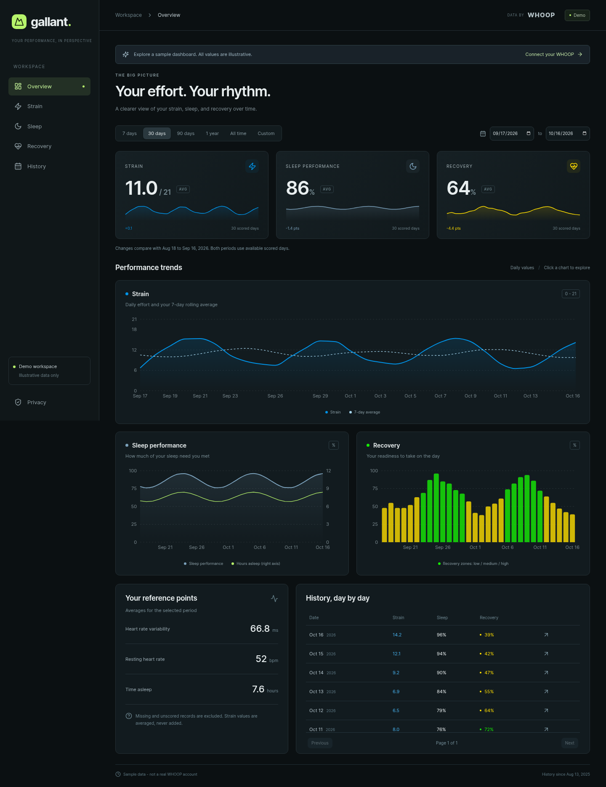

# Gallant Dashboard

[](https://github.com/ChrisTitusTech/gallant-dashboard/actions/workflows/ci.yml)

Your WHOOP strain, sleep, and recovery history in one private dashboard. Explore trends, compare periods, export your records, and optionally share a read-only view.

**[Open dashboard](https://whoop.3spinningplates.com/)** · **[Try the demo](https://whoop.3spinningplates.com/demo)** · **[Report a bug](https://github.com/ChrisTitusTech/gallant-dashboard/issues/new/choose)**



_The preview uses synthetic data. No member health records are included._

## Get started

1. Open the dashboard and choose **Connect your WHOOP**.
2. Sign in to WHOOP and approve access. Each member gets their own private dashboard.
3. Allow the initial history import to finish, then choose a date range to explore your records.
4. Use account controls to export data, manage sharing, disconnect WHOOP, or delete your account.

The first import fetches all history available through the WHOOP API. Larger histories can take longer because imports respect API request limits and resume automatically.

Gallant is an independent project, not an official WHOOP product. WHOOP is a trademark of its respective owner. The existing 3plates application, accounts, and database are independent.

## Project guide

- [Contributing and development workflow](CONTRIBUTING.md)
- [Security and private vulnerability reports](SECURITY.md)
- [Support and troubleshooting](SUPPORT.md)
- [Community guidelines](CODE_OF_CONDUCT.md)
- [Architecture](docs/architecture.md)
- [Implementation and acceptance status](TASKS.md)

Setup, validation, deployment, backup, restore, and API instructions follow below.

## Features

- WHOOP OAuth sign-in with private sessions and encrypted rotating tokens.
- Resumable full-history imports of cycles, sleep, recovery, and workouts, plus profile and current body-measurement snapshots.
- Strain, sleep, and recovery charts, rolling averages, prior-period comparisons, daily details, and private CSV/JSON exports.
- Sleep analytics: light/deep/REM totals, hours versus need, sleep-debt contribution, naps, efficiency, consistency, and recorded-local sleep timing.
- HRV and resting-heart-rate charts against personal 28-day baselines, requiring at least seven valid prior readings.
- A full-year calendar for recovery, strain, or sleep, with year selection and day-detail navigation independent of the chart range.
- Optional revocable public links exposing the full dashboard, without account data or raw exports.
- Signed v2 webhooks, hourly cycle polling, daily 14-day reconciliation, and weekly complete history reconciliation.
- Durable PostgreSQL jobs and an application-wide budget of 60 requests/minute and 8,000/day, below WHOOP defaults. Exhausted budgets defer jobs, including historical imports, rather than discarding work.

WHOOP's official API does not expose continuous heart-rate streams or a chronological sleep-stage timeline. Body measurements are snapshots starting with the first import, not reconstructed past history. Daily records follow WHOOP cycle relationships and recorded offsets; sleep naps remain separate. Long charts average daily values and never sum strain. Missing scores remain gaps.

## Local development

Requires Node 24, pnpm 9.15.4, and PostgreSQL 16. Install pnpm with `npm install -g pnpm@9.15.4` if needed.

```bash
pnpm install --frozen-lockfile
# Create a configuration only if one does not already exist:
test -f .env || cp .env.example .env
```

Keep the existing `.env` credentials. Add the other variables documented in `.env.example`, using a separate random `TOKEN_KEY` from `openssl rand -hex 32`. Never replace a deployed encryption key without re-encrypting stored tokens.

For a local database (Docker or Podman):

```bash
docker run -d --name gallant-dev-db \
  -e POSTGRES_USER=gallant -e POSTGRES_PASSWORD=development-only \
  -e POSTGRES_DB=gallant -p 127.0.0.1:5433:5432 postgres:16-alpine
pnpm db:migrate
pnpm dev:server
# Other terminals:
pnpm worker
pnpm dev
```

Visit http://localhost:5173/demo for synthetic data without connecting WHOOP. Local OAuth requires registering the local callback with WHOOP or using a separately configured HTTPS development origin. Production uses exactly `https://whoop.3spinningplates.com/callback`.

## Validation

```bash
pnpm check
# Isolated database; never point tests at the production database.
docker run -d --name gallant-test-db \
  -e POSTGRES_USER=gallant_test -e POSTGRES_PASSWORD=local-test-only \
  -e POSTGRES_DB=gallant_test -p 127.0.0.1:55433:5432 postgres:16-alpine
pnpm test:db
pnpm exec playwright install chromium
pnpm test:browser
shellcheck deploy/*.sh
shfmt -d deploy/*.sh
# After a production deployment, exercise the actual public site:
node deploy/smoke.mjs
```

Integration tests refuse databases not named `gallant_test`. They test OAuth state and replay rejection, session rotation, tenant isolation, public sharing/revocation, refresh races, interrupted pagination, reconciliation, v2 webhook IDs, deletion events, request budgets, disconnect, and account deletion. Browser tests cover desktop/mobile layout, long history, dialogs, sharing previews, and public restrictions.

## Production deployment

The VPS is reached with `ssh 3plates` (64.52.108.248). Use one task-scoped SSH master with `ControlMaster`, `ControlPath`, and `ControlPersist`, verify it with `ssh -O check`, reuse it for remote commands and rsync, and close it when finished. Do not bypass host-key verification.

Runtime layout:

- `/opt/gallant-dashboard/releases/<release>`: immutable built releases, owned by root.
- `/opt/gallant-dashboard/current`: active release symlink.
- `/etc/gallant-dashboard.env`: mode 600, root-owned server environment.
- `/etc/gallant-postgres.env`: mode 600, root-owned `POSTGRES_USER=gallant`, `POSTGRES_DB=gallant`, and independent random database password.
- `gallant-postgres`: dedicated PostgreSQL container and volume, exposed only on `127.0.0.1:5433`.
- `gallant-web.service`: unprivileged web service, `127.0.0.1:3100`.
- `gallant-worker.service`: unprivileged singleton import worker, no listener.
- `gallant-backup.timer`: nightly backups with 14-day retention.

Production environment extends the local WHOOP credentials with `DATABASE_URL`, `TOKEN_KEY`, `PUBLIC_URL=https://whoop.3spinningplates.com`, `PORT=3100`, and `NODE_ENV=production`. Transfer secrets over authenticated SSH without printing them. Keep a separate protected recovery copy of the encryption key and database credentials.

Build and validate locally, transfer `dist/`, `drizzle/`, `deploy/`, `package.json`, and `pnpm-lock.yaml` into a new release directory, then run:

```bash
# On the VPS, as root, substituting the concrete release directory:
bash /opt/gallant-dashboard/releases/RELEASE/deploy/activate.sh \
  /opt/gallant-dashboard/releases/RELEASE
bash /opt/gallant-dashboard/current/deploy/caddy.sh
curl -fsS https://whoop.3spinningplates.com/ready
curl -fsS https://api.3spinningplates.com/health
curl -I https://3spinningplates.com
curl -I https://forum.christitus.com
```

`activate.sh` copies locked production dependencies, makes public release files readable by the unprivileged service user, verifies runtime imports as that user, starts the separate database, backs up an existing deployment, applies migrations, switches releases, and checks readiness. A failed application health check restores the prior application symlink. Database changes must remain backward compatible for this rollback; inspect future migrations before deployment.

Caddy runs in Docker with host networking. The live configuration is **`/etc/caddy/Caddyfile.active`**, mounted as `/etc/caddy/Caddyfile` inside the container. `caddy.sh` backs up this file, preserves its inode, appends only the WHOOP hostname, validates, and reloads Caddy. It restores the previous configuration if validation or reload fails. If later public checks fail, copy the printed backup back over the active file and reload Caddy. Do not change existing 3plates or forum routes.

## WHOOP app settings and initial connection

In the WHOOP Developer Dashboard, verify:

- Redirect URL: `https://whoop.3spinningplates.com/callback`
- v2 webhook URL: `https://whoop.3spinningplates.com/api/webhooks/whoop`
- Privacy URL: `https://whoop.3spinningplates.com/privacy`
- Scopes: profile, cycles, sleep, recovery, workout, body measurements; the authorization request also includes `offline`.

Chris signs in with WHOOP and approves access. The account is identified by WHOOP's numeric user ID, not the display name or `@Titus42`. Other members follow the same flow. New WHOOP apps normally allow 10 connected members; verify the current app tier before wider enrollment and request increases through WHOOP.

Confirm all six initial imports complete, including the final pages of the four historical collections. Compare recent and older strain, sleep, and recovery records with the WHOOP app, including naps and dates near timezone changes. Live authorization, actual historical coverage, and event delivery cannot be proven using test fixtures.

## Operations, backup, and restore

```bash
systemctl status gallant-web gallant-worker gallant-backup.timer
journalctl -u gallant-web -u gallant-worker --since '1 hour ago' --no-pager
curl -fsS http://127.0.0.1:3100/ready
/opt/gallant-dashboard/current/deploy/backup.sh
/opt/gallant-dashboard/current/deploy/restore-test.sh \
  /var/backups/gallant/gallant-TIMESTAMP.dump
```

Readiness checks database connectivity and a worker heartbeat no older than three minutes. Failed imports appear in member sync status and worker logs; the account page can retry a complete import. Jobs resume after a worker restart. Expired sessions, OAuth states, webhook receipts, and completed job history are cleaned automatically.

Backups are root-readable PostgreSQL custom dumps under `/var/backups/gallant`, verified with `pg_restore --list`. `restore-test.sh` creates a unique scratch database, restores the full dump, checks tables, and drops only that scratch database. Local backups protect against application mistakes, not loss of the VPS; off-server backup transport is not configured.

A production restore is a separate destructive operation: stop both application services, take a safety backup, restore the selected dump into a fresh database, validate it, change the protected `DATABASE_URL` to that restored database, then restart and verify readiness. Keep the original database until validation completes. After a historical restore, invalidate restored sessions and sharing links and reapply any account deletions made since the backup before reopening public access; restoring a dump alone can resurrect deleted data.

## Interfaces

- `/auth/whoop`, `/callback`: OAuth; `/api/logout`: local sign-out.
- `/api/me`: profile and account deletion.
- `/api/me/dashboard?start=YYYY-MM-DD&end=YYYY-MM-DD`: date-filtered metrics and explicit safe details.
- `/api/me/sync`: job status or enqueue recent/full synchronization.
- `/api/me/sharing`: enable/revoke public link.
- `/api/me/export?format=csv|json`: private exports.
- `/api/me/disconnect`: revoke WHOOP access, stop jobs, disable sharing, retain private history.
- `/api/shared/{token}` and `/share/{token}`: read-only public dashboard.
- `/api/webhooks/whoop`: authenticated WHOOP event receiver.
- `/health`, `/ready`: liveness and database/worker readiness.

Mutations require the configured Origin and JSON content type. Sessions are HTTP-only, host-only cookies; OAuth states are single-use and browser-bound. Tokens are AES-256-GCM encrypted. Public responses use explicit field projection; raw WHOOP JSON is available only in the authenticated export. All dashboard and sharing responses use `Cache-Control: no-store`.

Official references: [API](https://developer.whoop.com/api/), [OAuth](https://developer.whoop.com/docs/developing/oauth/), [webhooks](https://developer.whoop.com/docs/developing/webhooks/), [rate limits](https://developer.whoop.com/docs/developing/rate-limiting/), [member tiers](https://developer.whoop.com/docs/developing/app-approval/).

## License

[MIT](LICENSE) - Copyright (c) 2026 Chris Titus.
