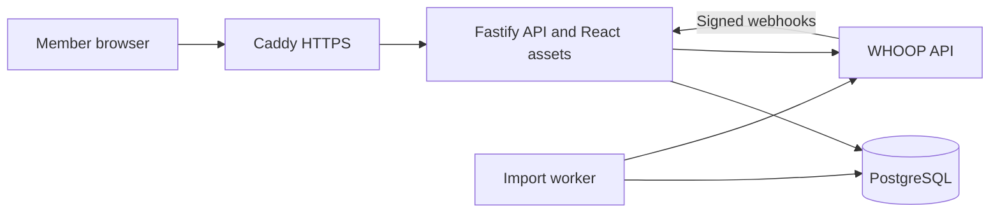

# Architecture

Gallant is a TypeScript application with a React frontend, a Fastify API, a separate import worker, and a dedicated PostgreSQL database.

## Repository map

| Path                              | Purpose                                                                   |
| --------------------------------- | ------------------------------------------------------------------------- |
| `web/`                            | React dashboard, charts, account controls, synthetic demo, and styles     |
| `server/app.ts`                   | HTTP routes, authentication, sharing, exports, and webhooks               |
| `server/whoop.ts`                 | WHOOP API requests, token refresh, and request budgets                    |
| `server/sync.ts`                  | Durable imports and reconciliation                                        |
| `server/worker.ts`                | Singleton worker and scheduled synchronization                            |
| `server/domain.ts`                | Metric projection and chart aggregation                                   |
| `server/security.ts`              | Token encryption and authentication helpers                               |
| `server/schema.ts` and `drizzle/` | PostgreSQL schema and migrations                                          |
| `tests/`                          | Unit, isolated database integration, and browser tests                    |
| `deploy/`                         | Release activation, systemd units, proxy setup, backups, and smoke checks |

## Connection and import

WHOOP OAuth uses a single-use, browser-bound state. The callback identifies the member by numeric WHOOP user ID, encrypts rotating tokens, creates a private session, and queues initial imports. A username is not used to retrieve someone else's data.

The worker imports cycles, sleep, recovery, and workouts through paginated API requests. Profile and body measurements are snapshots. Checkpoints and idempotent upserts let interrupted jobs resume. A shared database request budget limits API traffic across members. Hourly cycle polling, daily recent reconciliation, weekly full reconciliation, and signed webhook jobs keep records updated.

## Data boundaries

Sessions and every private query are scoped to a member. Public sharing is opt-in and revocable; public responses project allowed dashboard fields rather than exposing raw payloads or account credentials. Authenticated exports can include raw WHOOP data. Dashboard and sharing responses are not cached.

Missing scores remain gaps. Chart aggregation averages daily strain rather than adding it. Cycle relationships and recorded timezone offsets determine daily grouping. An associated completed main sleep anchors its cycle to the local wake date, including sleeps linked through recovery. Without main sleep, the stored local cycle date is the fallback. Related recovery, sleep, and interval-matched workouts use the same projected date; naps cannot move the cycle. Raw records remain unchanged.

Lifetime statistics use all member history, independent of the selected range. Daily metric averages and extrema exclude missing scores and retain zero. Sleep duration totals count scored main sleeps, with naps reported separately; workout duration includes only valid intervals and reports its observation count. Lifetime fields use the same member isolation and opt-in sharing boundaries as the dashboard.

## Operations

Web and worker services run separately as an unprivileged user. PostgreSQL and the HTTP listener bind to loopback, with Caddy terminating public HTTPS. `/health` is liveness; `/ready` also checks database connectivity and recent worker heartbeat.

See the [README](../README.md#production-deployment) for exact deployment commands, immutable releases, rollback limitations, backup checks, and restore procedures. Application rollback does not roll back schema migrations.
